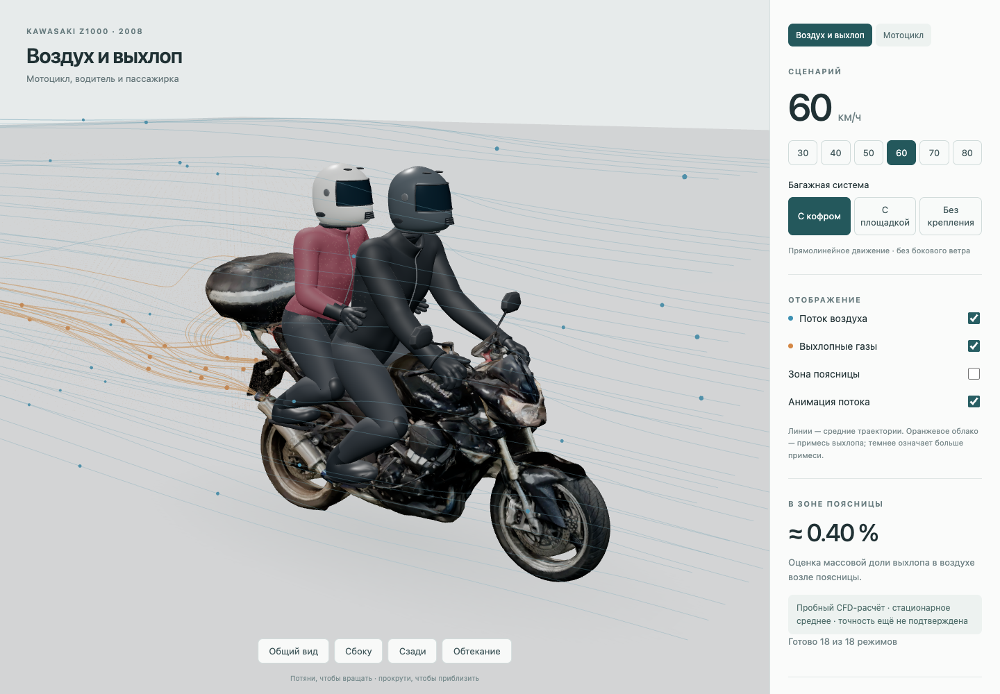

# Kawasaki Z1000 — Airflow & Exhaust

A 3D model of a 2008 Kawasaki Z1000, reconstructed from photos, with an interactive view of airflow and exhaust around the motorcycle, rider and passenger.

**[Open the simulation](https://swcake1.github.io/z1000-airflow/)** · [Explore the motorcycle in 3D](https://swcake1.github.io/z1000-airflow/motorcycle.html)



## Why this project exists

The starting point was an exhaust smell on the passenger's clothing around the lower back after some rides. Could the rear top case change the airflow and carry exhaust from the mufflers back toward the passenger?

This project was built to explore that idea: recreate the actual motorcycle, add both riders, and compare what happens when the luggage setup changes.

## What you can explore

Rotate and zoom the scene, show or hide airflow and exhaust, and compare speeds from **30 to 80 km/h** in three configurations:

- Top case with its mounting platform and support rails.
- Platform and support rails only.
- No top case, platform or support rails.

The viewer uses 18 precomputed scenarios, so no simulation software is needed to open it. The results are exploratory and have not been validated against measurements on the real motorcycle.

## Download the models

| Model | View on a Mac | Use in a 3D editor |
| --- | --- | --- |
| Motorcycle | [Download USDZ](https://swcake1.github.io/z1000-airflow/models/v2/kawasaki-z1000-2008-refined.usdz?v=plate-blurred-v1) | [Download GLB](https://swcake1.github.io/z1000-airflow/models/v2/kawasaki-z1000-2008-refined.glb?v=plate-blurred-v1) |
| Motorcycle with both riders | [Download USDZ](https://swcake1.github.io/z1000-airflow/simulation/z1000-two-riders.usdz?v=plate-blurred-v1) | [Download GLB](https://swcake1.github.io/z1000-airflow/simulation/assets/riding.glb?v=plate-blurred-v1) |

On a Mac, download a **USDZ** file, select it in Finder and press **Space** to open Quick Look. Textures are included in all model files.

## Run locally

Install **Node.js 22+** and **Python 3**, then run these commands from the project folder:

```sh
npm run setup
npm run build
npm run preview
```

Open [http://127.0.0.1:8767/](http://127.0.0.1:8767/).

## Key files

- `models/v2/` — motorcycle models in GLB and USDZ formats.
- `simulation/assets/riding.glb` and `simulation/z1000-two-riders.usdz` — the scene with both riders.
- `simulation/results/` — saved airflow and exhaust results for all 18 scenarios.
- `simulation/index.html` — the interactive simulation page.

Original photographs, Blender source files and working calculation files stay local and are not included in this repository.

[Third-party materials and licenses](THIRD_PARTY_NOTICES.md)
